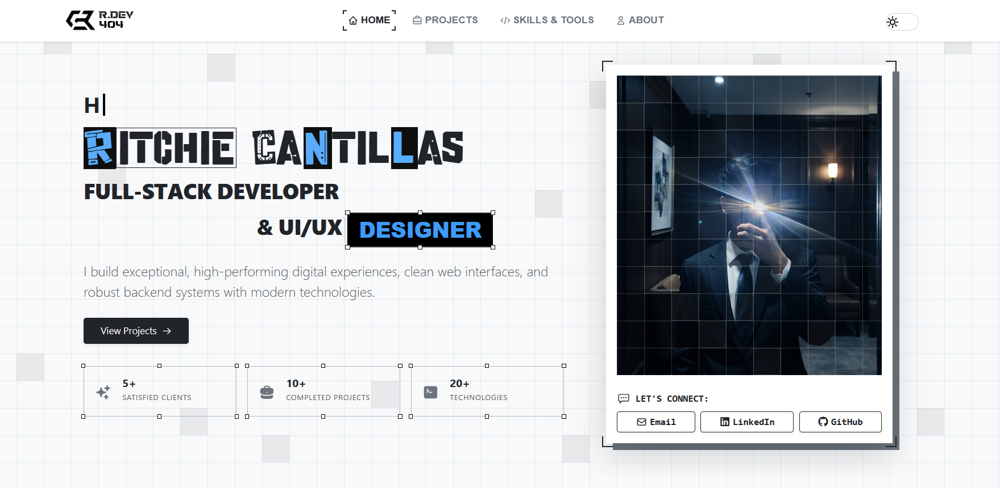

# Personal Portfolio v1.2

A modern, responsive personal portfolio built with React 19 and Vite, featuring smooth animations, client-side routing, and clean UI components.

## Tech Stack

- **Framework:** [React 19](https://react.dev/) (`^19.2.8`) & [Vite](https://vite.dev/)
- **Styling:** [Bootstrap 5](https://getbootstrap.com/) (`^5.3.8`)
- **Animations:** [Motion](https://motion.dev/) (`^13.1.0`)
- **Routing:** [React Router](https://reactrouter.com/) (`^7.18.2`)
- **Icons:** [React Icons](https://react-icons.github.io/react-icons/) (`^5.7.0`)
